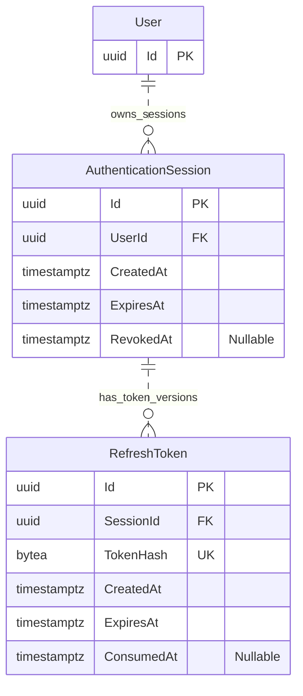

# Hospital Platform — Authentication Persistence Model

## 1. Purpose

This document defines technical authentication persistence for [ADR-0012](adr/0012-authentication-sessions.md), separately from the scheduling [ERD](ERD.md).

The session policy is accepted. Backend authentication is implemented with the AuthenticationSessions migration and the login, refresh, logout, and current-session endpoints. Browser cookie transport and production deployment settings remain separate implementation work.

## 2. Diagram

User is the existing account, shown only with its key. Sessions and refresh-token records are owned by Authentication; they do not introduce another profile type.

## 3. Constraints and Indexes

| Record | Constraint or index |
| --- | --- |
| AuthenticationSession | Required UserId foreign key to User.Id |
| AuthenticationSession | ExpiresAt greater than CreatedAt and no later than 7 days after CreatedAt |
| AuthenticationSession | Nullable RevokedAt; populated when revoked |
| AuthenticationSession | Index on UserId for account session revocation |
| RefreshToken | Required SessionId foreign key to AuthenticationSession.Id |
| RefreshToken | Required unique TokenHash containing a 32-byte SHA-256 digest |
| RefreshToken | ExpiresAt greater than CreatedAt |
| RefreshToken | Nullable ConsumedAt; populated when successfully rotated |
| RefreshToken | Partial unique index on SessionId WHERE ConsumedAt IS NULL |

The partial unique index permits multiple consumed versions but at most one unconsumed token row per session. It does not indicate whether that row is expired or its session is revoked; both conditions must be checked.

The refresh workflow requires token expiry not to exceed session expiry. Validate this cross-table condition in the coordinated session transaction. Do not implement a CHECK constraint that reads another table.

Create the session and initial token together. Do not overwrite a consumed token row with its replacement; preserve consumed hashes until session expiry to recognize reuse. The replacement uses the same SessionId and the original session deadline.

Foreign keys restrict deletion while dependent records exist. Cleanup removes expired sessions and token records in dependency order after the retention period. No client-visible session-management or logout-all feature is introduced by these indexes.

## 4. Session Lifecycle

- Login creates an independent session with an absolute 7-day deadline and one refresh-token version.
- Access JWTs have a maximum 15-minute lifetime, capped by the session's expiry, with sub identifying User.Id and sid identifying AuthenticationSession.Id.
- Refresh locks the session row and checks current account eligibility, session state, expiry, and token consumption.
- Successful rotation consumes the old row and inserts the new hashed token in one transaction.
- Reuse of a consumed token revokes its session. Commit that revocation even though the request returns a rejection.
- Logout revokes only the current session. Account suspension or deactivation revokes all of its sessions atomically with the status change.
- Reactivation requires a new login; revoked sessions are not restored.

Raw refresh tokens are generated from 32 cryptographically random bytes and returned only through the selected client credential transport. PostgreSQL stores their hashes. Access JWTs are not persisted as token records.

## 5. Current Authorization

Every protected request validates the JWT and reads the referenced session, its User ownership, expiry/revocation, current AccountStatus, and the profile data needed for permissions.

Permissions use current User.ProfileType and StaffRole. A valid signature does not override suspension, deactivation, ownership, or patient verification rules. Cache data is not authoritative for these checks.

PendingVerification patients may log in, refresh their session, log out, and read only their own account/profile, account and identity-verification status, and verification instructions. Deny all other protected patient operations, including profile updates and appointment management. Public specialty and doctor information remains accessible. Activation does not require a new login: subsequent checks use the current account status, while booking/rescheduling still require verified identity.

Revocation applies to subsequent checks. A write already executing still needs its normal transaction and concurrency validation.

## 6. Backend Implementation

- POST /api/auth/login validates credentials and creates a session plus its first refresh-token hash atomically.
- POST /api/auth/refresh consumes the old token and inserts its replacement under User-before-session locks. Reuse commits session revocation before returning 401.
- POST /api/auth/logout requires a bearer token and revokes only its current session, returning 204.
- GET /api/auth/session returns the caller's UserId, SessionId, ProfileType, and current AccountStatus. PendingVerification patients may access it and log out.
- Access tokens use HS256 with one configured random signing key of at least 32 characters, issuer HospitalPlatform, and audience HospitalPlatform.Api. Validate signature, allowed algorithm, issuer, audience, and expiry with zero clock skew. The local development key is stored in user-secrets; tests generate an isolated key per host. Replacing the configured key invalidates existing access JWTs; refresh sessions remain subject to their database state.
- Refresh credentials contain 32 random bytes represented as 64 hexadecimal characters. Store SHA-256 of the exact returned text, not the credential itself. Tokens are opaque and are not normalized.
- JwtSessionEvents reads current session ownership, expiry, revocation, account status, and staff role after JWT validation. Current profile/status/role claims are added from those database values for authorization.
- The default authorization policy requires an Active account. The explicit AuthenticatedAccount policy permits the accepted limited PendingVerification operations. Future own-profile reads must use that policy; other protected operations still need their feature permissions and ownership checks.
- Token responses currently use JSON bodies over HTTPS for API/native development. No cookie or automatic browser credential transport is configured. This does not finalize refresh-token storage for React Web.

## 7. Implementation Decisions Still Required

- Production signing-key storage and coordinated key rotation across instances.
- Web deployment origins, cookie scope/SameSite, CORS, and CSRF defenses for the proposed HttpOnly refresh cookie.
- Mobile secure-storage library and web refresh coordination across tabs.
- Retention/cleanup execution and future account-status services that revoke all sessions atomically on suspension/deactivation. Current authentication checks already deny blocked accounts; reactivation must not restore sessions revoked by those future status workflows.

## 8. References

- [Authentication Session ADR](adr/0012-authentication-sessions.md)
- [Architecture](Architecture.md)
- [PostgreSQL constraints](https://www.postgresql.org/docs/current/ddl-constraints.html)
- [PostgreSQL partial indexes](https://www.postgresql.org/docs/current/indexes-partial.html)
